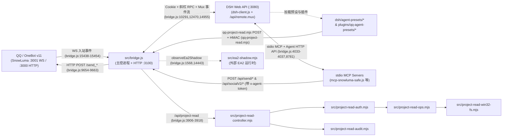

# P6：Project Intelligence 技术方案与架构基准（纯方案阶段）

> **阶段定位**：纯调研与方案设计阶段（只读源码梳理 + 方案设计）。
> **严格冻结声明**：本方案不修改任何生产源码、不扩大 `projectRead` 权限、不引入任何写入/Shell/Git/执行权限、不创建新的生产工具、不执行 Git commit / push。
> **事实纪律**：文中所有符号位置与行为结论严格区分 **【已验证事实】**（经逐文件/行号读取确认）、**【推断】**（基于命名/结构/引用线索合理推导但未完整展开实现）与 **【未知/未读范围】**（尚未逐行读取的实现细节）。

---

## 一、`qq-bridge` 项目架构地图（交付物 1）

### 1.1 顶层目录与职责划分【已验证事实】

> 注意：`docs/FOLDER_MAP.md` 与 `docs/MASTER.md` 成文于 2026-11-07，未涵盖 2026-11-14 新增的 `project-read-*` 与新交付文档；下表以当前实际目录扫描与源码读取为准。

| 目录 / 文件 | 角色定位 | 当前状态 / 关键文件示例 |
| --- | --- | --- |
| 根目录 | 入口说明、依赖与脱敏模板 | `package.json`、`README.md`、`README.en.md`、`RULES.md`、`config.example.json`、启动脚本（如 `start.bat`） |
| `src/` | 桥接主进程、MCP 服务与业务/安全子模块（共 73 个现役文件 + `.bak-*` 历史备份） | 单一主编排 `src/bridge.js`（15721 行），外加独立工具入口 `src/mcp-snowluma-safe.js` / `src/mcp-host-server.js` / `src/mcp-web-search-safe.js`，以及按领域拆出的工具/安全模块 |
| `plugins/qq-agent-presets/` | DSH Cordis agent preset bundle 与宿主侧插件 | `qq-project-read.mjs`（仅 `qq-chat-v2` 加载）、`qq-tool-restrict.mjs`（共享守卫）、`presets/qq-chat.patch.yml`、`presets/qq-chat-v2.patch.yml` |
| `dsh/agent-presets/` | DSH preset 源定义 | `qq-chat/agent.cordis.yml`、`qq-chat-v2/agent.cordis.yml`（构建生成物进 `plugins/qq-agent-presets/presets/`） |
| `scripts/` | 离线审计回归与运维脚本 | `test-audit.mjs`（串行执行 34 个离线回归脚本）、`test-project-read.mjs`（15 项用例）、`setup-dsh.mjs`、`build-agent-preset-patches.mjs`、`privacy-scan.mjs` |
| `docs/` | 运维指南、安全基线、状态日志与设计方案 | `README.md`、`STATUS.md`、`DEVLOG.md`、`MASTER.md`、`FOLDER_MAP.md`、`guides/PROJECT_READ.md`、`guides/SECURITY_BASELINE.md`、`guides/TOOL_SURFACE.md`、`plans/` |
| `state/` | 运行期敏感状态（被 `project-read-ops.mjs` 禁止读取） | `sessions.json`、`project-read-host-token.json`、`project-read-audit.jsonl`、`bridge.log`、`qq-activity.log`、`ea2-shadow-metrics.json`（含 `config.json` 共属运行态敏感区） |

### 1.2 `src/` 功能分区地图（基于 `src/bridge.js:15-160` 导入与文件名对照）

| 功能域 | 代表源码模块【已验证事实】 | 备注 |
| --- | --- | --- |
| **主控编排与 HTTP/WS 枢纽** | `src/bridge.js` | 负责 SnowLuma WS 客户端、DSH RPC/事件流消费、本地 HTTP 控制台及 Agent API（端口 3100）、各模式会话状态机 |
| **DSH 协议与 MCP 桥** | `src/dsh-client.js`（`NodeApiClient`、`createTurnCollector`）、`src/mcp-snowluma-safe.js`、`src/mcp-host-server.js`、`src/mcp-web-search-safe.js` | DSH `0.1.2+`/`0.2.0` 斜杠 RPC 与 `/api/remote.mux`；三个由 DSH spawn 的 stdio MCP server |
| **受限只读项目访问（P5）** | `src/project-read-controller.mjs`、`src/project-read-auth.mjs`、`src/project-read-ops.mjs`、`src/project-read-win32-fs.mjs`、`src/project-read-audit.mjs`、`src/state-acl.mjs` | 独立于 MCP 工具面，走 `/api/project-read` + HMAC-SHA256 + Win32 `NtCreateFile` 句柄链 + Fail-Closed 审计 |
| **会话/连接/成本/观测** | `src/snowluma-conn.js`、`src/conn-quality.mjs`、`src/health.mjs`、`src/rate-limit.mjs`、`src/context-budget.mjs`、`src/cost-guard.mjs`、`src/token-ledger.js`、`src/model-prices.js`、`src/ops-panel.js`、`src/ops-wait-store.mjs`、`src/dashboard.js`、`src/doctor.mjs`、`src/clean-state.mjs`、`src/backup.mjs`、`src/zip.mjs` | 支撑断线重连、上游心跳健康判断、限流队列、Token 与花费统计、巡检清理 |
| **仿真人格/表达/多模态** | `src/preset-prompt.js`、`src/role-card.js`、`src/scene-router.js`、`src/fewshot-lib.js`、`src/ai-tone.js`、`src/ai-tone-stats.js`、`src/md-to-plain.js`、`src/length-gate.js`、`src/v2-wait.js`、`src/turn-visibility.mjs`、`src/qq-model-view.js` | 人格与场景路由、AI 味检测、Markdown 转纯文本、长消息拆条与未完成输出判断 |
| **记忆/社交/媒体/语音** | `src/profiles.js`、`src/profile-slice.mjs`、`src/memory-decay.mjs`、`src/handoff.mjs`、`src/diary.js`、`src/slang-learner.js`、`src/reminders.js`、`src/reminder-nudge.js`、`src/proactive-contact.js`、`src/catch-up.mjs`、`src/wake-history.mjs`、`src/daily-brief.mjs`、`src/weekly-report.mjs`、`src/media-index.js`、`src/inline-media.js`、`src/media-note.js`、`src/send-image-lib.js`、`src/forward.js`、`src/sticker-lib.js`、`src/sticker-index.js`、`src/auto-sticker.mjs`、`src/voice-core.js`、`src/send-voice-lib.js`、`src/voice-tts.mjs`、`src/voice-window.mjs`、`src/auto-voice.mjs` | 群友三层记忆与半衰期衰减、日记/提醒/主动联系、贴纸检索与图片/TTS 语音收发 |
| **安全基础件与旁路实验** | `src/sensitive.js`、`src/safe-fetch.js`、`src/sampling-proxy.js`、`src/ea2-shadow.mjs` | 出站敏感审计正则、SSRF 防护拉取；`ea2-shadow.mjs` 动态桥接外部 EA2 影子实验 |

---

## 二、核心模块关系（交付物 2）

以下关系均依据已读取文件中的实际 `import`、函数调用与跨进程协议路径绘制，**未读取内部实现的细节均标注边界**：

### 关键安全与隔离边界【已验证事实】

1. **三层独立鉴权隔离**（`src/bridge.js:3905-4038`）：
   - `PROJECT_READ_ENDPOINT`（`/api/project-read`）排在控制台令牌逻辑之前（`bridge.js:3906-3918`），仅做回环 Origin 检查后直接委托给 `projectReadController.handleHttpRequest`，绝不降级接受 `consoleToken` 或 `x-agent-token`。
   - 控制台路由使用 `consoleToken`；声明 `x-agent-call` 的 MCP 工具调用强制校验活跃 `x-agent-token`（`bridge.js:3972-3977`），防止 confused deputy 越权到管理端；Agent HTTP 允许面限定在 `bridge.js:4033-4037`。
2. **Preset 工具面与执行面双重收敛**：
   - 聊天预设隔离：`qq-chat` 不加载 `qq-project-read`；只有 `qq-chat-v2` 注册 `id: qq-project-read`（`dsh/agent-presets/qq-chat-v2/agent.cordis.yml`）。
   - 工具守卫与后端反查：共用守卫 `plugins/qq-agent-presets/qq-tool-restrict.mjs` 在 `SAFE_EXACT` 放行 `qq_project_read` 名称，但后端 `ProjectReadAuthEngine`（`src/project-read-auth.mjs` Step 6）严格反查当前模式（`reserved2`）、`sessionPolicies`（`qq-chat-v2`）与管理员私聊（`private:<ownerQQ>`）。
3. **跨进程状态与文件交互面**：
   - `plugins/qq-agent-presets/qq-project-read.mjs` 通过 `fs.realpathSync.native` 穿透潜在目录 Junction 解析真实 `state/` 路径，每次实时读取 `state/project-read-host-token.json`（不缓存），且拦截一切 subagent 调用后签名请求 `/api/project-read`。
   - `src/project-read-win32-fs.mjs` 为唯一直接调用 Windows 原生 DLL（经 `koffi` 调 `NtCreateFile` 等）的安全读文件层；`README.md:337` 所述「无原生/注入面」针对的是 QQ 进程 Hook（区别于 SnowLuma 原生 DLL），项目读取层本身依赖 `koffi` 做 Win32 原生句柄防护。

---

## 三、消息处理调用链（交付物 3）

### 3.1 入站 → 会话与唤醒调度 → 模型执行 → 出站（基于已读源码行号）

1. **入口接收（`src/bridge.js:15438-15454`）**：
   - `main()`（`bridge.js:1563`）内建立 `new SnowLumaWebSocketClient(...)`。
   - 监听 `bot.onPrivateMessage`（`15444-15447`）与 `bot.onGroupMessage`（`15448-15451`），过滤机器人自身回环消息（`user_id === self_id`）后调用 `handleIncoming(kind, id, event, cfg)`。
   - 旁路监听 `bot.onEvent`（`15465-15477`）消费 `meta_event/heartbeat` 更新 `status.good` 上游健康度。
2. **准入过滤与预处理（`src/bridge.js:14437-14636`）**：
   - `modeAllowed(key, kind, id, cfg, currentMode)`（`14439` / 定义在 `3200-3207`）：`closed-agent` 仅允许 `private:<ownerQQ>`，其余模式核对白/黑名单。
   - `observeEa2Shadow(kind, id, event)`（`14443` / 定义在 `1568-1570`）：若 `ea2Shadow.enabled()` 为真，异步旁路观察（不影响主链路）。
   - 解析 `@`/引用原文与媒体引用（`14452-14477`，失败不阻断），提取 `isOwner`（`14483`）。
   - 若存在挂起的 `ask_user_question` 或管理员审批 `pending`（`14488-14492`），优先走 `handlePendingAnswer` 消费并返回。
   - 静默模式拦非管理员（`14495-14499`）、拦截非管理员角色控制语（`14502-14505`）、处理管理员硬命令 `/reset` `/new` `/status` `/role` `/silent` `/active`（`14508-14595`）。
3. **模式分流（`src/bridge.js:14600-14711`）**：
   - **`reserved2`（当前主模式，lines `14600-14625`）**：调用 `appendSocialV2Message` 将消息记入未读池并喂给黑话/档案提取窗口；未暂停时若是首轮触发 `scheduleWakeV2(key, 'bootstrap')`，否则由 `evaluateWakeTriggerV2` 判断是否调用 `scheduleWakeV2(key, reason)`；**不直接投递 prompt**。
   - **`chat` / `reserved` / `closed-agent`**：下滑至 `deliverPrompt(key, promptText, { media: mediaList })`（`14711`，其中 `14637-14710` 为普通模式拼装逻辑，【未逐行展开读取】）。
4. **唤醒合并与串行投递（`src/bridge.js:14264-14308`, `13930-14004`, `12413-12515`）**：
   - `scheduleWakeV2`（`14264`）：若在合并窗口内（默认 `batchWindowMs=8000`）按 `wakePriorityV2` 升级原因；若会话正忙（`isConversationBusyV2`），将 `{ reason, seq }` 暂存入有界数组 `pendingWakeReasons`（最多 20 条）；否则定时器触发 `sendWakePromptV2`（`13930` 附近预取历史并内联管理员图片，调用 `deliverPrompt`）。
   - `deliverPrompt`（`12509`）按 `key` 串行排队执行 `deliverPromptNow`（`12413`）：DSH 未就绪时进入内存队列（上限 `QUEUE_MAX` 50）；就绪后调用 `ensureSession(key)`（`10240-10333`）。
   - `ensureSession` 对非 `closed-agent` 执行 **strict fail-closed preset 校验**（缺失合法 preset 拒绝回退 `standard`），通过 `api.workspace.create` + `api.sessions.create` + `api.events.follow` + `ensureChatModel`（`10213-10238`）建立并持久化 `state.sessions[key]` 与 `state.sessionPolicies[key]`。
   - `deliverPromptNow` 为唤醒补建实时消息快照 JSON（`12453-12457`），解析图片多模态分片后调用 `api.sessions.prompt({ sessionId, mode: 'queue', content })`（`12470`）。
5. **DSH 回合事件回流与出站发送（`src/bridge.js:14955-15275`、`5244-8835`、`9632-9670`、`10191-10203`）**：
   - **DSH 事件流循环**（`14955-15085`）：按帧统计 Token（`recordSessionUsage`），跟踪 `turn/start`、`tool/call`（记录发送工具 `callId` 到 `pendingSendToolCalls`）与 `tool/result`（成功则标记 `sendToolSucceededSessions`），由 `createTurnCollector()` 累积直到回合结束（`ended`）。
   - **`reserved2` 主动发送通道**：模型在回合内通过 MCP 工具（`src/mcp-snowluma-safe.js`）请求 Bridge HTTP 端点 `/api/socialV2/send-message`（`6119`）、`/api/socialV2/send-burst`（`5933`）或 `/api/send/group|private|reply`（`8781-8835`），经 `x-agent-token` 会话绑定、`modeAllowed`、`SENSITIVE_RE` 与 `KNOWN_AGENT_TOKENS` 检查后，最终通过 `onebotSend`（`9632-9670`）向 SnowLuma `httpUrl` 发送 `POST /send_private_msg` 或 `/send_group_msg`。
   - **回合结束兜底与防遗忘（`15060-15272`）**：
     - `reserved2` 下记录无行动计数（达上限重置 `wakeConfig`），校验 `pendingWakeKeys` 防遗忘提醒（未调 `qq_mark_read`/`qq_set_wake_config` 则补发一次提醒），若存在繁忙期暂存的 `pendingWakeReasons` 且对应消息未回应则补调度 `scheduleWakeV2`。
     - 若模型只输出普通文本而未调发送工具：在 `reserved2` 下文本属 AI 内部输出（**不自动转发 QQ**，若命中敏感审计在 `15228-15230` 静默丢弃并打日志）；在 `chat`/`reserved` 下经 `mdToPlain`、`SENSITIVE_RE` 检查（或 `auditAndSend` `10191`）与分条时间线经 `sendToQQ`/`sendBurstToQQ` 发往 QQ。

### 3.2 `qq_project_read` 旁路工具调用链（已冻结，已实测）

`DSH Agent (qq-chat-v2)` → DSH 插件 `plugins/qq-agent-presets/qq-project-read.mjs`（校验非 subagent、逐调用提取 `exec.agent.session.id`、实读 `state/project-read-host-token.json`、生成时间戳/Nonce/HMAC-SHA256）→ `POST http://127.0.0.1:3100/api/project-read` → `src/bridge.js:3906-3918` → `ProjectReadController.handleHttpRequest`（Header/Body 上限与 `Connection: close`）→ `ProjectReadAuthEngine.verifyAndExecute`（Step 1~6：Token 存在 → 签名 & Nonce → **在这之后** `JSON.parse` & Schema → 项目白名单 → 反查 `state.sessions`/`sessionPolicies` 仅允许 `reserved2` + `qq-chat-v2` + `private:<ownerQQ>`）→ `ProjectReadAuditLogger.withAuditFailClosed`（`state/project-read-audit.jsonl` 先落盘后放行）→ `executeProjectReadAction` → `src/project-read-win32-fs.mjs`（`NtCreateFile` 逐级防重解析点 + `FILE_ID_INFO` 强校验读取）→ `wrapUntrustedContent`（随机定界符 + `SENSITIVE_RE` / 密钥脱敏）→ 返回给 DSH 模型。

---

## 四、当前项目状态总结（交付物 4）

1. **`qq_project_read` 第一阶段交付完成并冻结**：P5-03.1 验收通过，`config.json` 冻结为 `projectRead.enabled = true`、`owner-private`、`qq-bridge` 白名单、`qq-chat-v2` 隔离，无写入/Shell/Git/执行权限。
2. **实测与审计口径清晰诚实**：
   - 真实 QQ 测试完成 `tree` / `read` / `search`、多页连续分页（4 页与 3 页）、敏感路径与穿越拒绝（`ACCESS_DENIED` / `INVALID_PATH`）及非授权会话拒绝（`UNAUTHORIZED_SESSION`）。
   - `node scripts/test-project-read.mjs`：**14 passed / 1 skipped / 0 failed**（非提权 Win32 file symlink `EPERM` 诚实记 `SKIPPED`）。
   - `node scripts/test-audit.mjs`：**34/34 脚本退出码 0**（含个别环境条件跳过项，详见 [docs/STATUS.md](../STATUS.md)）。
3. **当前已定位运行期异常**：`state/bridge.log` 持续出现 `[ea2-shadow] 事件旁路失败 kind=private：The requested module 'node:sqlite' does not provide an export named 'backup'`；此外存在部分历史文档索引滞后问题（见第六节）。

---

## 五、P6：Project Intelligence 技术方案（交付物 5）

### 5.1 核心约束与反幻觉原则

为了使 `qq-chat-v2` 仅依赖只读的 `qq_project_read`（单次返回上限约 12KB / 200 行 / `tree` 200 项）准确理解约 70+ 个模块、1.5 万行级主控的 `qq-bridge` 项目，同时杜绝幻觉与过期误导，方案设立**四项铁律**：

1. **零扩权铁律**：全部能力完全运行在现有 `qq_project_read`（`tree`/`read`/`search`）能力之内，**不放宽路径白名单、不开放 `state/`/`config.json`/`.git`、不增加任何写入/Shell/Git 工具、不新增任何生产工具**。
2. **证据锚定强制（No-File-Line-No-Claim）**：任何模块职责、调用关系、配置键、故障定位输出，必须附带本轮 `read`/`search` 实际返回的 `<file>:<startLine>-<endLine>` 与精确符号名；未通过 `read` 看到函数定义与调用表达式的边，**严禁当作“已验证调用链”输出**。
3. **三元认知标签**：输出统一划分为 **「已验证事实」**（亲自 `tree`/`read`/`search` 命中并核对上下行）、**「推断」**（由 `import` 声明或端点字符串推导，尚待追踪内部分支）与 **「未知/待读取」**（截断未读、`partial=true` 或超出当前配额）。
4. **索引不得替代当前源码**：任何预设背景、README、STATUS、DEVLOG 或缓存摘要仅作**导航线索（Hint）**，不得直接作为源码实现结论；涉及代码行为判断必须实时用 `qq_project_read` 对目标源码切片回读核验（Read-Through Verification）。

### 5.2 八项核心研究能力的实现方案设计

#### 能力 1：项目目录结构分析
- **配额约束（已验证于 `src/project-read-ops.mjs`）**：单次 `tree` 上限 `maxEntries=200`、`maxDepth=5`，根目录整树会被截断（`truncated: true`）。
- **设计方案（分层按需下钻协议）**：
  1. 先调用 `tree(path="")` 获取顶层目录骨架与根文件清单，识别被截断的子目录。
  2. 对 `src`、`plugins`、`dsh`、`scripts`、`docs` 分别发起带 `path` 的局部 `tree`（如已验证 `tree("src")` 与 `tree("scripts")` 均可一次完整返回 `truncated: false`）。
  3. **过滤噪声**：自动折叠 `*.bak-*` 历史备份文件与已归档路径，将真实现役源文件与备份文件分栏呈现；明确识别 `state/`、`config.json`、`.git` 等因安全策略被拦截的目录，不误判为“目录不存在”。

#### 能力 2：核心模块识别
- **设计方案（静态入口枢纽度 + 导出拓扑法）**：
  1. 读 `package.json` 确认主入口、scripts 命令与运行时依赖。
  2. 通过 `read` 分段扫描 `src/bridge.js` 头部导入区（如 `1-165` 行），提取被主编排文件直接 `import` 的一等核心模块名单；再通过 `search(path="src", query="export ")` 盘点独立进程入口（如 `mcp-snowluma-safe.js`、`mcp-host-server.js`、`mcp-web-search-safe.js`）与各子模块公开 API 面。
  3. 按职责聚合为 6 个架构域（见 §1.2），结合 `plugins/qq-agent-presets/` 与 `dsh/agent-presets/` 识别跨进程插件面。

#### 能力 3：入口与调用链追踪
- **痛点**：`src/bridge.js` 单文件超 1.5 万行，单次 `read` 最多 200 行 / 12KB，直接全读必然耗尽上下文。
- **设计方案（锚点定位 + 有界切片跳转法）**：
  1. 先用字面 `search(path="src/bridge.js", query=...)` 定位外部事件与协议入口锚点（如 `main()`、`SnowLumaWebSocketClient`、`handleIncoming(`、`deliverPrompt(`、`ensureSession(`、`api.sessions.prompt`、`PROJECT_READ_ENDPOINT`、`onebotSend(`、`auditAndSend(`）。
  2. 围绕每个命中行号调用 `read(startLine, endLine)` 拉取函数完整实现窗口（若函数超过 12KB / 被 `truncated: true` 截断，按返回末行 `lastReadLine + 1` 连续分页直到关键控制流结束）。
  3. 仅在逐行读取并看到显式调用语句后，才建立 `Caller(file:line) -> Callee(file:line)` 有向边；若中间某段分支被跳过未读，必须标为「未知分支」。

#### 能力 4：模块依赖关系
- **设计方案（三层依赖视图）**：
  1. **静态编译期依赖**：批量用 `search(path="src", query="from './")` 与 `search(path="plugins", query="import ")` 收集全仓库相对导入，生成有向无环（或环检测）模块依赖表。
  2. **跨进程 HTTP / RPC / Stdio IPC 依赖**：用 `search` 匹配 `/api/` 路由表（`bridge.js` 与 `mcp-snowluma-safe.js`）、`Stdio` MCP 注册点（`setup-dsh.mjs` / `dsh-client.js`）和 `PROJECT_READ_ENDPOINT`，补齐静态 `import` 看不到进程间调用边。
  3. **【推断防护】**：`search` 命中字符串（例如注释里的路由或未调用封装）不自动等于依赖成立，需对引用行做 `read` 上下文核对以排除注释与死代码。

#### 能力 5：README、STATUS、DEVLOG 联合分析
- **设计方案（三文档交叉对账 + 源码真值仲裁）**：
  1. **角色分工**：`README.md` 提供架构设计意图与操作契约，`docs/STATUS.md` 提供当前冻结基线、最新实测口径与已知故障，`docs/DEVLOG.md` 提供时间线演化与最近改动范围。
  2. **冲突消解（Source-of-Truth Rule）**：
     - 当旧指南（如 `MASTER.md` / `FOLDER_MAP.md`）与 `STATUS.md`、`DEVLOG.md` 冲突时，以最新日期文档标记 + **实际源码核验**为准；
     - 当所有文档（含 `STATUS.md`）与当前源码（如 `src/`、`config.example.json`、`dsh/agent-presets/`）不一致时，**以实际 `read` 到的源码为唯一真值**，并主动向管理员报告「文档漂移项」而非沿用旧结论。

#### 能力 6：测试文件与源码对应关系
- **设计方案（四维映射矩阵构建）**：
  1. 通过 `tree("scripts")` 枚举全部 `test-*.mjs`（实测 40+ 个单测/审计脚本），再读取 `scripts/test-audit.mjs`（约 72 行）识别哪些被纳入全量离线回归门禁（当前 34 个）。
  2. 用 `search(path="scripts", query="../src/")` 与 `search(path="scripts", query="src/")` 提取源码 import 与静态源码字符串断言，建立 `源码模块 ↔ 测试脚本 ↔ 回归门禁状态` 映射表（例如：`project-read-*.mjs` ↔ `test-project-read.mjs`、`ea2-shadow.mjs` 是否无测试覆盖等）。
  3. **诚实标注覆盖盲区**：明确区分「单元测试断言导入」「静态文本正则断言」「需真实环境/管理员权限而 `SKIPPED` 的用例」及「完全无测试覆盖的模块」。

#### 能力 7：技术债务与潜在问题定位
- **设计方案（基于已验证缺陷模式的只读巡检清单）**：
  1. **多进程运行期问题线索**（不直接读 `state/*.log`，而在管理员提供日志报错线索时定位对应源码）：例如针对 `[ea2-shadow] ... 'node:sqlite' does not provide an export named 'backup'`，先用 `search("src", "ea2-shadow")` 定位，再 `read("src/ea2-shadow.mjs", 100, 170)` 核验外部 `DEFAULT_EA2_ROOT` 动态加载点与错误处理逻辑。
  2. **架构级技术债识别**：
     - 单体膨胀风险：`src/bridge.js`（15721 行）与 `src/mcp-snowluma-safe.js`（1982 行）承担过多模式耦合与 HTTP 路由分发；
     - 仓库备份与旧文档漂移：`src/*.bak-*` 文件散布现役目录、`FOLDER_MAP.md` / `MASTER.md` 滞后于当前代码；
     - 测试覆盖盲区识别（如哪些 `src/*.mjs` 未被 `scripts/test-audit.mjs` 的 34 个脚本覆盖）。
  3. 本阶段发现的所有问题仅形成**只读诊断报告与优先级建议**，不擅自修改代码。

#### 能力 8：项目知识索引的增量更新机制（只读环境下的防过期架构）
- **核心问题**：第一阶段冻结禁止新建持久化写入工具，且不允许将旧知识索引当成现行源码。
- **方案设计（会话级只读指纹校验 + 按需局部失效协议）**：
  - **存储形态（P6 方案设计，暂不落新生产工具）**：将来实施时，知识索引只保存「**目录树摘要 + 核心模块指针（路径+行号区间+关键导出指纹）+ 文本内容特征指纹（如文件总行数/关键行原文片段/最后核对日期）**」，而不把整份旧解读当成事实数据库。
  - **两阶段增量刷新流程**：
    1. **快速漂移探测（Cheap Staleness Probe）**：会话开始或被问及某模块时，先用一次 `tree(path)` + 针对上次记录行号区间的小范围 `read(startLine, endLine)` 或关键词 `search`，检查：
       - 目标文件是否仍在 `tree` 中、或有新增/删除文件；
       - 关键函数定义是否仍停留在原记录行号附近且核心签名未变；
       - `docs/STATUS.md` 与 `docs/DEVLOG.md` 的最新日期条目是否晚于索引生成时间。
    2. **局部重读与失效重算（Targeted Invalidation）**：
       - **未漂移模块**：仍对要被引用的具体实现行号执行最小窗口 `read` 后再引用（确保遵守实时源码核验，避免行号微小偏移造成误指）；
       - **已漂移模块**：立即将旧索引中该模块及下游依赖边的状态标记为 `STALE`，触发局部 `search` 重新锚定行号并分页 `read` 重建该子图；
       - **无法验证（如配额截断或目录新增过多）**：强制将该区域状态标为 `UNKNOWN`，拒绝用历史索引补齐。

---

## 六、已验证项目现状盲区与技术债初判（基于本轮实读）

1. **`src/ea2-shadow.mjs` 运行期旁路失败（已验证事实 + 推断）**：
   - **已验证**：`state/bridge.log` 多次记录 `[ea2-shadow] 事件旁路失败 kind=private：The requested module 'node:sqlite' does not provide an export named 'backup'`；`src/ea2-shadow.mjs:103-116` 动态 `import` 外部路径 `../../../ChatGPT/QQ/dist/src/index.js` 并实例化 `core.SqliteStore(dbPath)`。
   - **推断**：外部 `EA2` 构建产物引用了当前 Node 运行时 `node:sqlite` 模块中不存在的 `backup` 命名导出，导致每次 `ensure()` 初始化失败；因为不在本仓库内，需检查该外部产物或当前 Node 版本兼容性。
   - **未知**：`../../../ChatGPT/QQ/dist/src/index.js` 具体在哪一行引用 `backup` 属于本白名单项目外路径，当前无法读取核实。
2. **源码备份文件堆积与测试映射空白（已验证事实）**：
   - `src/` 存在 7 个 `.bak-*` 历史快照文件（`bridge.js.bak-*` 5 份、`dashboard.js.bak-*`、`mcp-snowluma-safe.js.bak-*` 2 份、`sticker-lib.js.bak-*`、`voice-tts.mjs.bak-*`），会增加 `tree`/`search` 噪音。
   - 经对 `scripts/test-*.mjs` 的 `src/` 导入扫描，部分模块（如 `src/ea2-shadow.mjs`、部分工具模块）未在静态 `import` 列表中出现独立单测覆盖（具体全量调用覆盖待逐一核对未读取测试脚本后确认）。
3. **跨预设共享守卫与文档快照滞后（已验证事实）**：
   - `docs/MASTER.md`（2026-11-07）与 `docs/FOLDER_MAP.md` 尚未收录 `project-read-*` 模块组。
   - `plugins/qq-agent-presets/qq-tool-restrict.mjs` 为 `qq-chat` 与 `qq-chat-v2` 共享，靠 `qq-chat` 未加载插件与 Bridge Step 6 完成实际隔离。

---

## 七、后续实施路线（交付物 6 — 待授权后启动）

> 以下路线均为规划建议，**当前停留在设计结束节点，任何实施步骤均须获得管理员明确授权后才可执行**。

| 阶段 | 目标与内容 | 前置授权门禁 | 预计影响面 |
| --- | --- | --- | --- |
| **P6-A（零代码验证阶段）** | 仅通过优化 `qq-chat-v2` 提示词 / 操作规程，让 AI 在现有 `qq_project_read` 约束下实测按本方案八项能力输出项目分析，校验行号准确率与无幻觉表现 | 仅在对话/评审或 `qq-chat-v2` 提示词调整授权后执行；仍零源码权限扩张 | 不动 Bridge 核心与安全链 |
| **P6-B（只读诊断基线与技术债排查）** | 针对已定位问题（如 `ea2-shadow.mjs` 的 `node:sqlite` 报错、`src/` `.bak-*` 清理评估、`MASTER.md`/`FOLDER_MAP.md` 同步）逐项排查并出修复提案 | 需明确解除“不得修改源码”冻结的专项授权 | 低风险运维/文档/局部旁路修复 |
| **P6-C（可选的增量索引/检索增强评估）** | 仅当 P6-A 证明纯按需分页 `tree/read/search` token 开销或准确率确有瓶颈时，才评估是否需要在 Bridge 只读内部建立纯内存/只读索引（仍严禁模型写入/执行权限） | 须重新立项并过 `SECURITY_BASELINE.md` 五步审查与全量 `test-project-read` 扩展 | 需同步更新测试与安全基线 |
